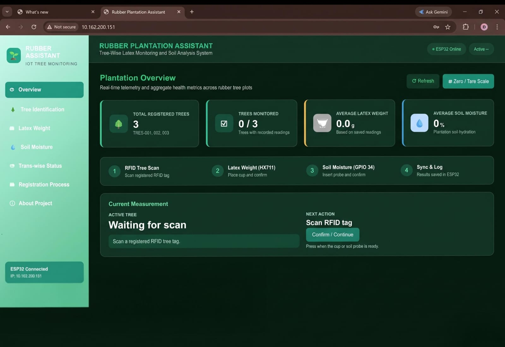

# Rubber Latex Monitor (ESP32)

A portable device for tree-wise latex monitoring in rubber plantations.

> 🚧 Source code will be added soon.

## How it works
1. Scan the RFID tag on a tree
2. The OLED shows the tree ID and asks you to place the latex on the load cell
3. The load cell (HX711) measures the latex weight
4. The soil moisture sensor reads the moisture around the tree
5. The ESP32 creates its own WiFi network and serves a local dashboard showing the readings

## Hardware
ESP32, MFRC522 RFID reader, load cell + HX711, OLED (SSD1306), capacitive soil moisture sensor

## Software
Arduino IDE, ESP32 board package, libraries: MFRC522, Adafruit SSD1306, Adafruit GFX, HX711

## Images
**Front view**

**Top view**

**Dashboard**

## Report
[Project report (PDF)](On%20device%20rubber%20plant%20assitance.pdf)

## My role
I was responsible for the embedded system development of the project, including ESP32 programming and integration of the RC522 RFID reader, HX711 load cell, and OLED display. I worked on implementing tree identification, latex weight measurement, and displaying the corresponding tree ID and weight through the OLED interface.

## What I learned
ESP32 programming using Arduino IDE.
Interfacing RFID (RC522) with ESP32 using SPI communication.
Interfacing a load cell with HX711 for weight measurement.
OLED display interfacing using I2C.
Sensor integration, GPIO configuration, and debugging.
Combining multiple hardware modules into a single embedded system.
